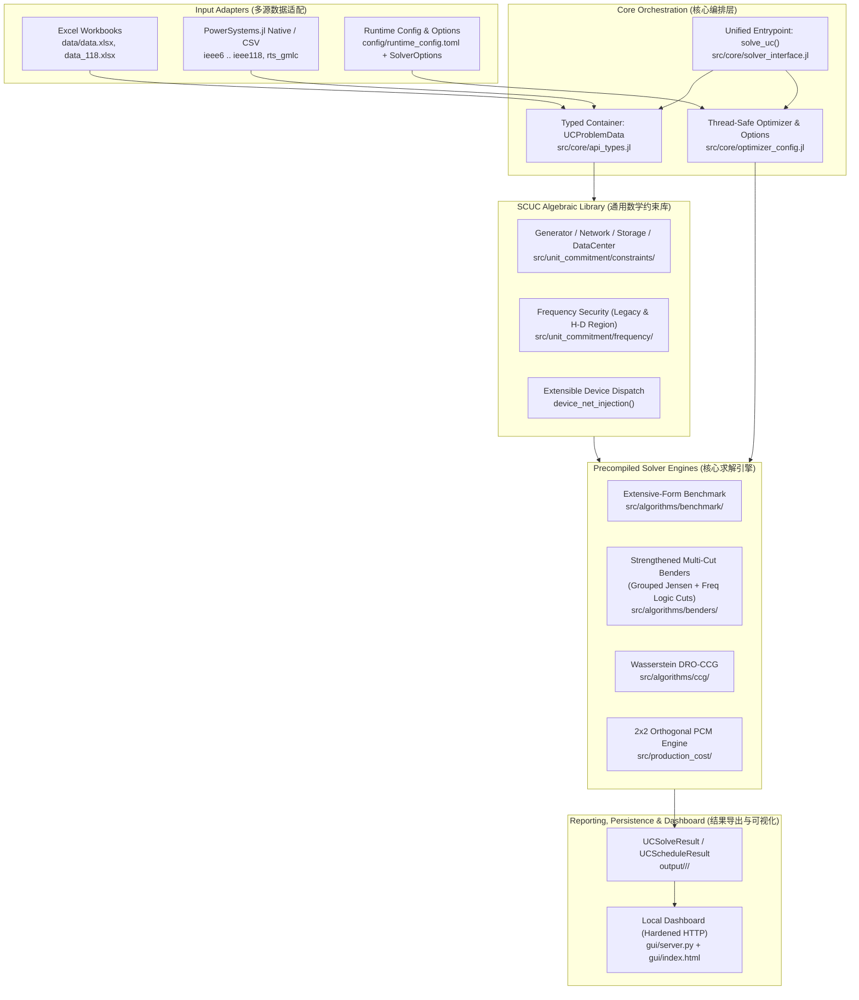
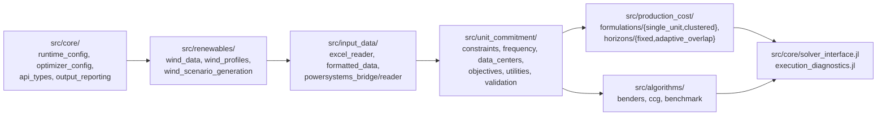

# ModuleUnitCommitmentToolkit.jl

`ModuleUnitCommitmentToolkit` is an industrial-grade Julia package for **Security-Constrained Unit Commitment (SCUC)**, **Stochastic / Wasserstein DRO Unit Commitment**, **Strengthened Multi-Cut Benders Decomposition**, **H–D Frequency Security Region Modeling**, and **2×2 Production Cost Modeling (PCM)**.
(工业级安全约束机组组合与生产成本模拟工具包，通过统一入口 `solve_uc` 调度四大求解算法族。)

| Algorithm Family | Selector | What It Solves |
| --- | --- | --- |
| **Benchmark (Extensive Form)** | `:benchmark` | Full-scenario deterministic-equivalent SCUC reference solve (optional Wasserstein DRO). |
| **Strengthened Benders** | `:benders` | Multi-cut Benders decomposition with **per-group Jensen inequality cuts**, **monotone frequency commitment logic cuts**, and BESS-aware master adequacy cuts. |
| **C&CG / Wasserstein DRO** | `:ccg` | Column-and-constraint generation dynamically internalizing worst-case scenarios under empirical or Wasserstein ambiguity sets ([`docs/algorithms/wasserstein_dro_ccg.md`](docs/algorithms/wasserstein_dro_ccg.md)). |
| **Production Cost Modeling (2×2 PCM)** | `:pcm_standard`, `:pcm_clustered`, `:pcm_adaptive_overlap`, `:pcm_clustered_adaptive`, `:pcm_integrated` | Orthogonal **Single-Unit / Homogeneous-Clustered × Fixed / Adaptive-Overlap** rolling-horizon PCM + integrated full-horizon benchmark. |

## Status

- **Version**: `1.14.0`
- **Julia**: `1.10+`
- **License**: MIT
- **Solvers**: JuMP with Gurobi (default), HiGHS, or GLPK via thread-safe `SolverOptions` / `with_uc_optimizer`.
- **Module**: `ModuleUnitCommitmentToolkit`

---

## System Architecture & Execution Workflow (系统架构与执行流程)

### 1. Overall System Architecture (系统总体架构图)



### 2. Module Dependency Graph (模块加载与依赖关系)



### 3. Core Execution & Data Flow Sequence (核心业务与数据流转时序图)

```mermaid
sequenceDiagram
    autonumber
    actor User as User / CLI / GUI
    participant API as solve_uc() [solver_interface.jl]
    participant Loader as load_uc_data() [readers.jl]
    participant Builder as apply_scuc_constraints!() [modular_activator.jl]
    participant Solver as Benchmark / Benders / CCG / PCM
    participant Report as print_uc_result() [output_reporting.jl]

    User->>API: UCSolveRequest(algorithm, input, calibration, solver_options)
    API->>API: Validate calibration keys & bind task-local SolverOptions
    API->>Loader: Load Excel or PowerSystems case + generate wind scenarios
    Loader-->>API: UCProblemData (units, loads, winds, lines, storages, data_centers)
    API->>Solver: Dispatch by algorithm (:benchmark / :benders / :ccg / :pcm_*)
    Solver->>Builder: Assemble JuMP variables, objectives & modular constraints
    Note over Solver,Builder: Benders adds grouped Jensen cuts + monotone frequency logic cuts;<br/>CCG adds worst-case recourse scenarios; PCM rolls across horizons.
    Builder-->>Solver: Solved JuMP model / converged decomposition bounds
    Solver-->>API: Algorithm payload (status, objective, lower_bound, gap, details)
    API->>Report: Wrap in UCSolveResult & persist CSV/JSON artifacts to output_dir
    Report-->>User: UCSolveResult + formatted summary tables
```

### 4. Stage-to-Code Quick Reference (各阶段核心文件与入口速查)

| Pipeline Stage | Key File(s) | Primary Entrypoint(s) |
| --- | --- | --- |
| Package Root & Exports | [`src/ModuleUnitCommitmentToolkit.jl`](src/ModuleUnitCommitmentToolkit.jl) | `using ModuleUnitCommitmentToolkit` |
| Unified Request & Dispatch | [`src/core/solver_interface.jl`](src/core/solver_interface.jl), [`src/core/api_types.jl`](src/core/api_types.jl) | `solve_uc`, `UCSolveRequest`, `UCProblemData`, `UCSolveResult`, `UCScheduleResult` |
| Thread-Safe Solver Config | [`src/core/optimizer_config.jl`](src/core/optimizer_config.jl), [`config/runtime_config.toml`](config/runtime_config.toml) | `SolverOptions`, `with_solver_options`, `build_uc_model`, `load_runtime_config!` |
| Multi-Source Data Ingestion | [`src/input_data/readers.jl`](src/input_data/readers.jl), [`src/input_data/excel_reader.jl`](src/input_data/excel_reader.jl), [`src/input_data/powersystems_bridge.jl`](src/input_data/powersystems_bridge.jl) | `load_uc_data`, `read_excel_sheets`, `format_uc_input_data`, `build_system_from_powersystems` |
| SCUC Constraints & H–D Frequency | [`src/unit_commitment/constraints/modular_activator.jl`](src/unit_commitment/constraints/modular_activator.jl), [`src/unit_commitment/constraints/network.jl`](src/unit_commitment/constraints/network.jl), [`src/unit_commitment/frequency/hd_estimation/hd_uc_adapter.jl`](src/unit_commitment/frequency/hd_estimation/hd_uc_adapter.jl) | `apply_scuc_constraints!`, `device_net_injection`, `add_hd_frequency_constraints!`, `add_multi_area_hd_frequency_constraints!` |
| Extensive-Form Benchmark | [`src/algorithms/benchmark/extensive_uc.jl`](src/algorithms/benchmark/extensive_uc.jl) | `solve_benchmark_uc`, `solve_benchmark_uc_powersystems` |
| Strengthened Benders | [`src/algorithms/benders/setup.jl`](src/algorithms/benders/setup.jl), [`src/algorithms/benders/decomposition.jl`](src/algorithms/benders/decomposition.jl), [`src/algorithms/benders/models/master_problem.jl`](src/algorithms/benders/models/master_problem.jl) | `build_benders_setup`, `multiple_benders_decomposition_scuc`, `build_jensen_subproblem_groups`, `add_master_frequency_logic_cuts!` |
| Wasserstein DRO-CCG | [`src/algorithms/ccg/solver.jl`](src/algorithms/ccg/solver.jl), [`src/algorithms/ccg/dro_uncertainty.jl`](src/algorithms/ccg/dro_uncertainty.jl) | `solve_ccg_unit_commitment` |
| 2×2 Production Cost Modeling | [`src/production_cost/rolling_engine.jl`](src/production_cost/rolling_engine.jl), [`src/production_cost/formulations/clustered/master_solver.jl`](src/production_cost/formulations/clustered/master_solver.jl) | `run_pcm`, `run_pcm_benchmark`, `PCMConfig` |
| Local Web Dashboard | [`gui/server.py`](gui/server.py), [`gui/build_html.py`](gui/build_html.py) | `./gui/start.sh` |

---

## Installation

```julia
using Pkg
Pkg.develop(path = "/path/to/ModuleUnitCommitmentToolkit.jl")
```

From a clone, instantiate the project and verify the solver:

```bash
julia --project=. -e 'using Pkg; Pkg.instantiate()'
julia --project=. -e 'using Gurobi; println(Gurobi.Env())'
```

## Quick Start

```julia
using ModuleUnitCommitmentToolkit

result = solve_uc(
    algorithm = :benchmark,       # :benchmark, :benders, :ccg, or :pcm_*
    input = :excel,               # :excel, :powersystems, or :powersystems_csv
    scenario_limit = 1,
    solver_options = SolverOptions(mip_gap = 0.01, threads = 4, silent = true),
    calibration = (
        MODEL_CONSIDER_BESS = false,
        MODEL_CONSIDER_FREQUENCY_CONTROL = false,
        BENCHMARK_UC_USE_DRO = false,
    ),
    output_dir = "output/quickstart",
    verbosity = :summary,
)

println(result.status)            # Unified contract across all algorithms
println(result.objective)         # Optimal / best incumbent objective
println(result.runtime_seconds)   # Wall-clock solve time
println(result.output_dir)
```

### Strengthened Benders & Frequency Security

```julia
result = solve_uc(
    algorithm = :benders,
    input = :excel,
    scenario_limit = 6,
    calibration = (
        MODEL_CONSIDER_FREQUENCY_CONTROL = true,
        FREQUENCY_MODEL_MODE = "hd_region",
        FREQUENCY_NADIR_LIMIT_HZ = 0.8,
        BENDERS_ENABLE_JENSEN_CUTS = true,
        BENDERS_ENABLE_FREQUENCY_LOGIC_CUTS = true,
    ),
    verbosity = :summary,
)
```

### PowerSystems.jl Native Cases

```julia
sys = build_system_from_powersystems(:ieee30)
result = solve_uc(
    algorithm = :benchmark,
    input = :powersystems,
    sys = sys,
    scenario_limit = 1,
    horizon = 24,
    frequency_parameters = generate_frequency_parameters(sys),
    calibration = (MODEL_CONSIDER_FREQUENCY_CONTROL = true,),
    output_dir = "output/powersystems/ieee30/benchmark",
    verbosity = :summary,
)
```

Supported case aliases include `:ieee6`, `:ieee14`, `:ieee24`, `:ieee30`, `:ieee118`, `:c_sys5_all_components`, `:rts_gmlc`, `:activsg2000`, and `:activsg10k` (inspect via `list_powersystems_cases()`).

## Calibration Keys

Calibration values apply only to a single `solve_uc` call without leaking into global `ENV`. Full reference: [`config/runtime_config.toml`](config/runtime_config.toml) and [`docs/guides/runtime_configuration.md`](docs/guides/runtime_configuration.md).

| Parameter | Effect |
| --- | --- |
| `MODEL_CONSIDER_DATA_CENTER` / `MODEL_CONSIDER_BESS` | Enable data-center flexible load / energy storage constraints |
| `MODEL_CONSIDER_FREQUENCY_CONTROL` / `FREQUENCY_MODEL_MODE` | Enable frequency security (`"legacy"`, `"hd_region"`, `"hybrid"`) |
| `MODEL_IS_NETWORK_CON` / `MODEL_NUM_SEGMENTS` | Enable DC-OPF GSDF network limits / PWL fuel-cost segments |
| `BENDERS_ENABLE_JENSEN_CUTS` / `BENDERS_JENSEN_MAX_GROUPS` | Enable per-group Jensen inequality cuts in Benders (default: enabled, up to 4 groups) |
| `BENDERS_ENABLE_FREQUENCY_LOGIC_CUTS` | Enable static cardinality/cover & dynamic time-lifted monotone frequency logic cuts |
| `CCG_DRO_ENABLED` / `CCG_DRO_RADIUS` | Enable Wasserstein DRO worst-case distribution in CCG & Benchmark |
| `PCM_METHOD` / `PCM_OVERLAP_MODE` / `PCM_LOAD_PROFILE` | Configure 2×2 PCM formulation, overlap selector, and load profile |

## Repository Layout

```text
src/
├── ModuleUnitCommitmentToolkit.jl    Package root & centralized exports
├── core/                             API types, SolverOptions, runtime config, unified dispatch
├── input_data/                       Excel & PowerSystems.jl readers and boundary checks
├── renewables/                       Wind profiles & stochastic scenario simulation
├── unit_commitment/                  SCUC constraints, H–D frequency security, data centers, utilities
├── algorithms/                       Precompiled Benchmark, Strengthened Benders, and DRO-CCG
├── production_cost/                  2×2 orthogonal PCM engine (single/clustered × fixed/adaptive)
└── visualization/                    Standalone plotting utilities
tools/                                CLI drivers & PCM benchmark comparison runners
examples/unified_api/                 Runnable `solve_uc` examples
config/runtime_config.toml            Default runtime switches
docs/                                 Guides, algorithm notes, and development docs
test/                                 Core, algorithm, PCM, PowerSystems, and GUI test suites
gui/                                  Optional local HTML dashboard (hardened HTTP server)
```

## Documentation & Examples

- [`examples/unified_api/README.md`](examples/unified_api/README.md) — unified API walkthroughs
- [`docs/guides/api_reference.md`](docs/guides/api_reference.md) — public functions, types, and CLI entry points
- [`docs/guides/runtime_configuration.md`](docs/guides/runtime_configuration.md) — calibration keys and TOML precedence
- [`docs/guides/powersystems_algorithms_guide.md`](docs/guides/powersystems_algorithms_guide.md) — PowerSystems bridge and frequency parameters
- [`docs/guides/clustered_pcm_engineering_guide.md`](docs/guides/clustered_pcm_engineering_guide.md) — clustered PCM architecture and disaggregation
- [`docs/development/testing.md`](docs/development/testing.md) — test suite organization
- [`docs/development/juliahub_publishing.md`](docs/development/juliahub_publishing.md) — registry release guide

## Testing

```bash
julia --project=. -e 'using Pkg; Pkg.test()'
julia --project=. test/core/test_fast_interface.jl
julia --project=. test/algorithms/test_smoke_algorithms.jl
python3 -m unittest discover -s test/gui -v
```

## Local Dashboard

```bash
./gui/start.sh
```

Listens on `127.0.0.1` by default. Remote binding requires `MODULE_UC_GUI_ALLOW_REMOTE=1`, a bearer token (`MODULE_UC_GUI_TOKEN`), and an explicit origin allow-list (`MODULE_UC_GUI_ALLOWED_ORIGINS`).

## License

MIT License — see [`LICENSE`](LICENSE). Third-party solvers (Gurobi, HiGHS, GLPK) and dependencies retain their own licenses.
